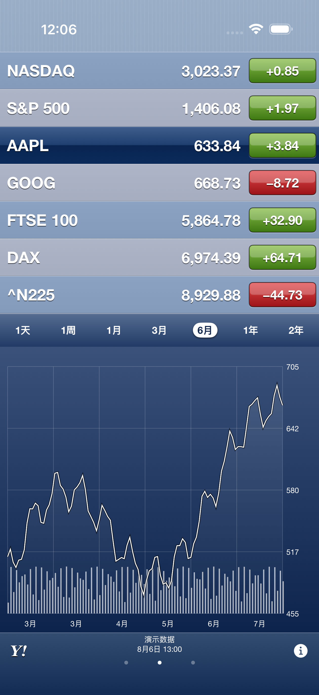

# StocksSix

A native SwiftUI recreation of the iOS 6 Stocks interface for iPhone, requiring iOS 17 or later.

Open `StocksSix.xcodeproj`, or select **StocksSix** in the collection's `iOS6Apps.xcworkspace`. No API key or third-party Swift package is required.



## Classic interface

The original composition is preserved: no added main navigation bar; alternating blue/slate quote rows; a third, deep-blue selected-row treatment; glossy green/red change controls; three horizontally paged summary, chart, and news panels; seven chart ranges; a Yahoo Finance link and an information button. Rotating either way presents a full-screen chart. Charts include price grid lines, volume bars, localized dates, press-and-drag inspection, and two-finger interval comparison. A quick horizontal swipe changes information pages; the three page indicators also select them directly.

The quote list uses alternating blue and slate row surfaces, with a separate dark-navy selected row. The information panel spans the full content width; the plot retains internal space for readable axis labels. Its compact 48-point footer shares space between quote metadata and page indicators, giving the chart 40 more points of height than the previous 88-point footer at the default text size.

Tap any change value to cycle price change, percentage change, and market capitalization. Tap the information button to add, remove, or reorder symbols. Hold a management row and drag it over another row to move it before that row; VoiceOver exposes Move Up and Move Down actions. News opens its source URL and supports the system share menu through a long press. Quotes refresh every minute while the app is active. Pull the watchlist down or hold a page indicator and choose Refresh Quotes to refresh manually.

The [shared design language](../../docs/design-language.md) applies to materials, dimensional controls, safe areas, localization, and accessibility. The main page keeps Stocks' own specialized layout. Management uses dark linen and an independent glossy navigation panel. The status area retains the blue pinstripe surface. On the main screen, the footer's dark blue gradient continues behind the Home indicator, while its controls stay inside the safe area. Management retains its own continuous linen surface. This reviewed Stocks treatment takes precedence over the shared guide's default of matching the top and bottom body material. No artificial device frame or status bar is drawn. The icon and chart artwork are original programmatic drawings.

Historical visual and interaction references: [Apple's iOS 6 iPhone User Guide, Stocks chapter, pages 91–92](https://cdsassets.apple.com/live/6GJYWVAV/user/ma1658_iphone_ios6_user_guide.pdf). The supplied conversation's image references were not downloadable image attachments, so the Apple manual's actual screenshots were inspected directly.

## Data and persistence

Normal launches request Yahoo Finance chart data and symbol search/news over HTTPS. The adapter uses the public web endpoints `/v8/finance/chart/` and `/v1/finance/search`, which are unofficial, can change or reject requests, and have no guaranteed availability or latency. Do not describe the data as guaranteed real-time. Missing metrics appear as `—`; historical chart baselines are never passed off as the previous day's closing price. Daily quotes and chart data are retained locally with their original timestamps. Failures keep cached quotes visible, show an unavailable/cached notice, and expose retry controls. News retains its publisher's original language.

The watchlist, ordering, selected symbol, range, and change display persist on this device. Search combines a small bilingual local catalog with live results; local fallback is explicitly labeled when online search fails. Default symbols match the iOS 6 manual's seven-row example.

Launch with `--demo` for an isolated watchlist and **Demo Data** label. Quotes and curves in this mode are synthetic fixtures inspired by the manual, not current or verified historical market data. Headlines are explicitly labeled demonstrations. `--ui-testing` uses a separate resettable domain; `--preserve-test-state` retains only that test domain for relaunch tests. Demo data never overwrites normal quote caches or the user's normal watchlist.

English and Simplified Chinese follow Weather's language rules: all `zh*` variants use Simplified Chinese, other languages fall back to English. UI text, known company/index names, formatting, accessibility labels, and the Home Screen name are localized. Stock identifiers and publisher content retain their original values. Change the system or per-app language in iOS Settings.

Modern iOS cannot reproduce the original built-in Notification Center ticker. This independent project does not register an Apple system ticker or enable iCloud watchlist synchronization; watchlists are local. Market capitalization is displayed only when the provider supplies it. Reading List is available through the system URL-sharing actions where the OS offers it.

## Simulator browser

```sh
./scripts/serve_sim.sh <simulator-udid>
```

Open the URL printed by serve-sim in Codex's side browser and keep that terminal alive. The script cleans up only its selected simulator's helper. On a checkout managed by a file provider, use a temporary build directory to avoid inherited Finder metadata breaking code signing:

```sh
xcodebuild -project StocksSix.xcodeproj -scheme StocksSix \
  -destination 'platform=iOS Simulator,name=iPhone Air' \
  -derivedDataPath /private/tmp/StocksSix-DerivedData build
```

## Validation

Run `python3 scripts/verify_resources.py` for resource consistency. The shared scheme includes unit tests for provider decoding, missing data, language rules, persistence, async response ownership, and error recovery, plus UI tests for the main flows and rotation. See [verification evidence](docs/verification.md).

Regenerate the project or resources with `scripts/create_project.py`, `scripts/generate_localizations.py`, and `scripts/generate_icon.py`. Icon generation requires Pillow.
